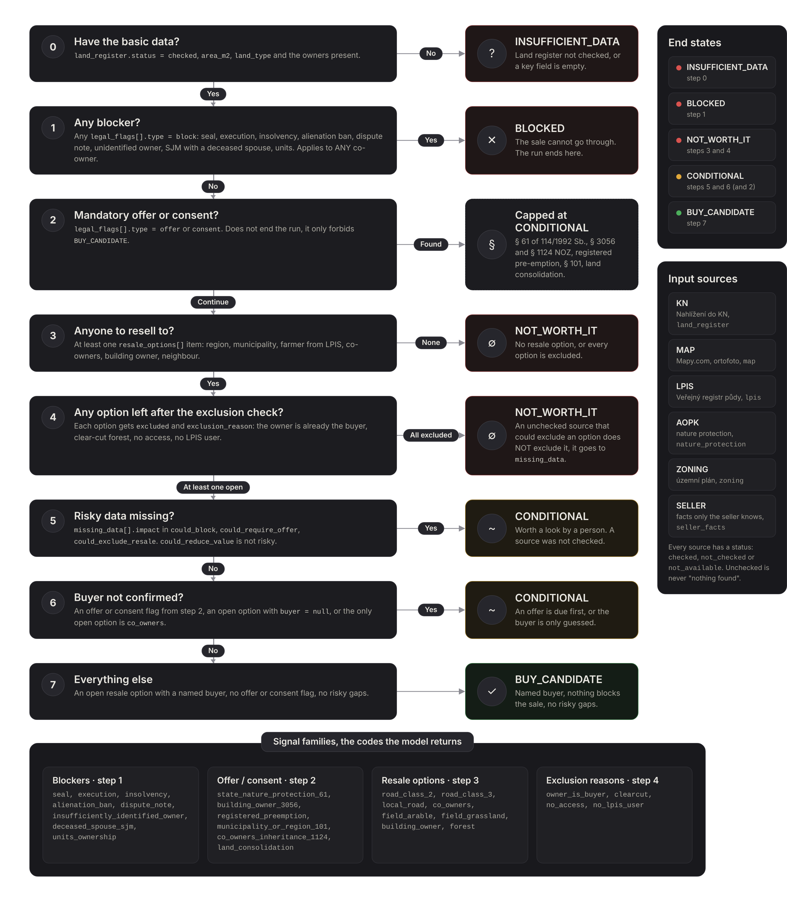
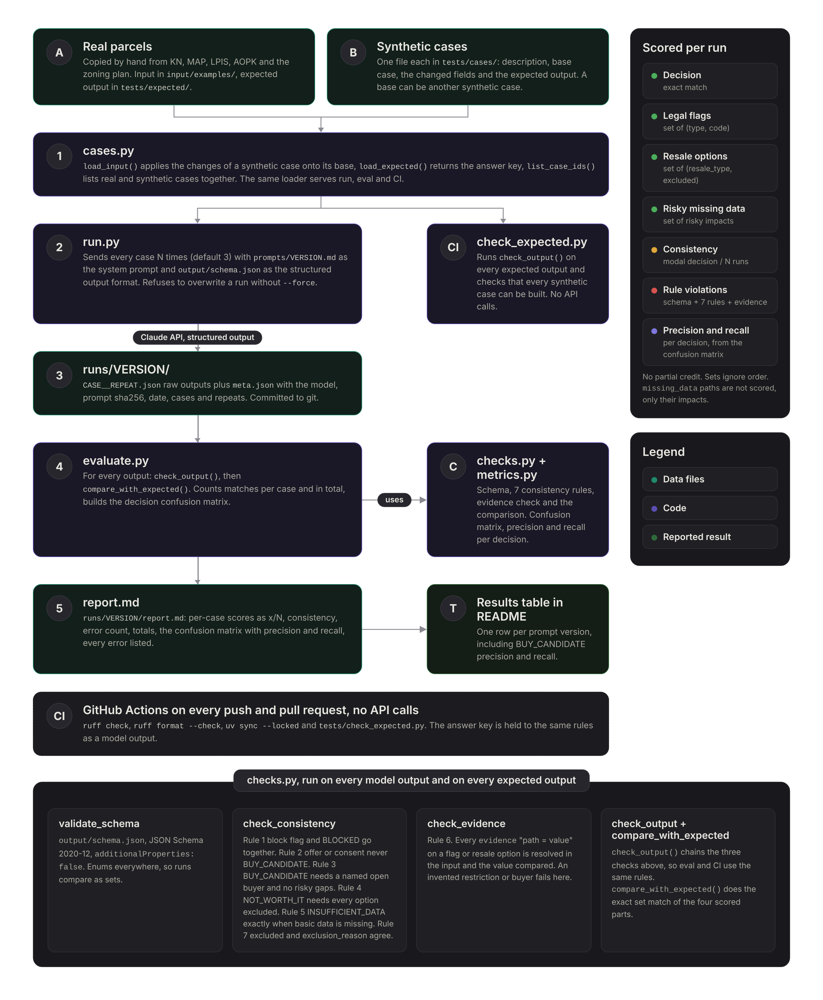

# Czech Parcel Eval

An LLM prompt and eval harness that evaluates Czech land parcels before a buyout.
The model gets data about one parcel copied from public registries (KN, LPIS, AOPK, zoning plans) and returns a structured verdict - whether the parcel can be bought, who would buy it afterwards, and what data is missing to be sure.

**Built as a technical assignment.**

## The problem

Some companies buy small land parcels and co-ownership shares that their owners consider worthless, and resell them to a buyer for whom they have real value. Finding out which parcels are worth it means going through the land register and several map portals for every single parcel, which is too slow and expensive to do by hand.

- **Inherited shares** - people often inherit a share of a field (a couple of percent) they cannot use on their own. They cannot rent it out, fence it or build on it, and it is NOT specified which part of the parcel is theirs, so for the owner such a share is almost worthless.
- **Natural buyers** - the same parcel usually has someone who needs it - the region (kraj) for land under a II. or III. class road, the municipality (obec) for a local road, the farmer who uses the field according to LPIS, the owner of a building standing on the land (§ 3056 NOZ), the other co-owners, or a neighbour for a forest.
- **Co-ownership** - a co-owner can sell the share to anybody or ask the court to dissolve the co-ownership (žaloba na zrušení a vypořádání spoluvlastnictví), which the court HAS TO process. The other co-owners are therefore a resale option too, just not a confirmed one.

The model does the first pass over each parcel, so a person only reviews the candidates it finds.

## Results

Each case runs 3 times and the scores are counted per run. The dev set (40 cases) was used to iterate the prompt. The holdout set (4 real parcels collected after the prompt was tuned) ran once, with the final prompt, and the prompt was not changed afterwards.

| Prompt | Model | Decision | Legal flags | Resale options | Risky missing data | Consistency | Rule violations | BUY_CANDIDATE precision | BUY_CANDIDATE recall |
|---|---|---|---|---|---|---|---|---|---|
| v0 | claude-sonnet-5-5 | 81 % | 100 % | 97 % | 70 % | 35/40 unanimous | 0 | 100 % | 23 % |
| v1 | claude-sonnet-5-5 | 99 % | 100 % | 98 % | 92 % | 39/40 unanimous | 0 | 100 % | 97 % |
| v2 + findings v2 | claude-sonnet-5-5 | 100 % | 100 % | 99 % | 100 % | 40/40 unanimous | 0 | 100 % | 100 % |
| **v2 + findings v2, holdout** | claude-sonnet-5-5 | **100 %** | **100 %** | **92 %** | **100 %** | **4/4 unanimous** | **0** | **100 %** | **100 %** |

v0 → v1: one prompt line rewritten so that `null` in a `checked` source means "verified, empty" rather than "not found".

v1 → v2: the § 1124 rule now counts owner entries, with SJM as one entry (the model treated a married couple as two co-owners), and `missing_data` lists every unchecked source that could add an offer obligation, even when the verdict is already `CONDITIONAL`. Two expected outputs were corrected to that rule. v0 and v1 are scored against the original expected outputs. v2 runs with the optional `other_findings` add-on (see Decisions and assumptions).

## Tech Stack

- **Language** - Python 3.11+
- **Model** - Claude (`claude-sonnet-5-5` by default) through the Anthropic API with structured outputs
- **Schemas** - JSON Schema 2020-12 for the model output, an empty JSON form for the input
- **Validation** - `jsonschema` plus custom consistency and evidence checks
- **Data sources (manual)** - Nahlížení do KN, Mapy.com, LPIS, AOPK, municipal zoning plans
- **Tooling** - uv, ruff, GitHub Actions

## How it works

1. **Input (`input/schema.json`)** - one JSON per parcel, with a section for each source. Every section has a `status` (`checked`, `not_checked` or `not_available`), so the model can tell "verified, nothing found" from "nobody looked". Values are copied verbatim from the Czech sources.
2. **Prompt (`prompts/v2.md`, final)** - walks the parcel through a fixed order of steps taken from `docs/decision_table.md`:
    * **Data** - missing basic land register data ends with `INSUFFICIENT_DATA`.
    * **Blockers** - a seal (plomba), seizure of property (exekuce), insolvency, alienation ban etc. ends with `BLOCKED`.
    * **Pre-emption and consent** - a statutory offer (§ 61 of 114/1992 Sb., § 3056 and § 1124 NOZ) or an authority consent caps the result at `CONDITIONAL`.
    * **Resale options** - who would buy the parcel (region, municipality, farmer from LPIS, co-owners, building owner, neighbour).
    * **Exclusion check** - resale options that are excluded (the owner is already the buyer, clear-cut forest, no LPIS user etc.).
    * **Verdict** - `CONDITIONAL` when risky data is missing or the buyer is not confirmed, otherwise `BUY_CANDIDATE`, or `NOT_WORTH_IT` when no resale option remains.

    

3. **Output (`output/schema.json`)** - six fields (`decision`, `legal_flags`, `resale_options`, `missing_data`, `confidence`, `reasoning`). Codes are enums, so runs can be compared as sets. An optional seventh field, `other_findings`, is described under Decisions and assumptions.
4. **Run (`run.py`)** - sends each test case to the model N times and saves the raw outputs and a `meta.json` (model, prompt hash, add-on version, date) to `runs/PROMPT/`, or `runs/PROMPT_findings_ADDON/` with the `other_findings` add-on.
5. **Evaluation (`evaluate.py`)** - validates every output against the schema, checks the 7 consistency rules (including the evidence), compares it with the hand-written expected output and writes `runs/PROMPT/report.md`. The report also has a confusion matrix of expected vs returned decisions with precision and recall per decision, because the two mistakes cost different things - a false `BUY_CANDIDATE` wastes a person's time, a false `NOT_WORTH_IT` loses a parcel.

  

## Decisions and assumptions

- **Evaluation, not a decision** - the agent identifies potentially valuable parcels for a human. Every `BUY_CANDIDATE` and `CONDITIONAL` still goes to a person who opens the LV.
- **Unchecked is not empty** - a `not_checked` source never counts as "nothing found". If it could change the result, the model has to list it in `missing_data` and the verdict is at most `CONDITIONAL`.
- **Evidence for every conclusion** - each flag and resale option carries `evidence` in the form `input.path = value` (e.g. `land_register.owners[0].name = Liberecký kraj`). The evaluation resolves the path in the input and compares the value, so an invented restriction or buyer is caught automatically.
- **Whole parcel or nothing** - an execution or insolvency of ANY co-owner blocks the parcel, even though legally it only affects that owner's share. The profit comes from selling the whole parcel, which such a share complicates.
- **No prices in the model** - the model only names the resale option (`road_class_3`, `field_vineyard`, `building_owner` etc.) and never estimates a price, since a price from the model's memory would be invented. Specialty cultures (vineyard, orchard, hopfield) have their own resale types, because the buyer, the price per m² and the market are different from arable land.
- **Value-lowering factors are left out** - mortgages, leases or a flood zone do not change the verdict, and the person checking a candidate sees them on the LV anyway.
- **Manual input** - Nahlížení do KN shows owners only after login and does not allow automated scraping. Bulk use would need the paid land register web services (WSDP) and WMS/WFS layers for LPIS and AOPK.
- **The taxonomy is not complete, and the project has a way to extend it** - with `run.py --other-findings v2` the model also lists every risk or opportunity that no enum covers (`other_findings`, e.g. an easement of unknown scope). These findings never change the verdict and are never scored, so the metrics stay deterministic and a correct observation outside the categories is not counted as a failure. The report lists them by case and marks the cases where the decision missed, because a finding there may point to a missing code rather than a model error. Findings that repeat become new codes in the decision table, the prompt and the expected outputs. The first runs surfaced a municipality as the seller (a sale needs a council decision under § 39 of the Municipalities Act), sources that contradict each other (an orthophoto showing a meadow on a local road) and a pre-emption right with an unknown beneficiary, listed as a backlog in `prompts/iterations.md`. Adding the field is measured like any prompt change - the first add-on version made the model list resale options on `BLOCKED` parcels (resale options 106/120 vs 117/120), so add-on v2 restates that `BLOCKED` ends the evaluation.
- **Known blind spots** - statutory pre-emption rights are not always visible in the land register, and consent with public use of a road (Constitutional Court I. ÚS 2541/25) cannot be detected from any source. Facts only the seller knows go to `seller_facts`.

## Quickstart guide

### Prerequisites
- Python 3.11 or newer
- [uv](https://docs.astral.sh/uv/)
- Git
- Anthropic API key

### Setup

```bash
git clone https://github.com/Jpoker01/czech-parcel-eval.git
cd czech-parcel-eval
uv sync
```

Copy `.env.example` to `.env` and fill in your API key. The `.env` file is ignored by git:

```txt
ANTHROPIC_API_KEY=sk-ant-...
```

### Test data

**The test set contains real parcels and synthetic variants of them.**
Real parcels are copied by hand from Nahlížení do KN and the other sources, with names of private persons replaced by `Osoba A`, `Osoba B` etc. Each one covers a resale option or a legal flag (field with an LPIS user, land under a third-party garage, forest, national park, execution etc.). Inputs live in `input/examples/<case_id>.json`, expected outputs in `tests/expected/<case_id>.json` (see `docs/adding_test_cases.md` for the collection procedure).

The `syn_*` cases in `tests/cases/` take a real parcel or another synthetic case and change one thing, so that each one isolates a single rule (seal, execution, national park, prompt injection in `notes`, unchecked sources etc.). `syn_road_private_owner` is the shared starting point, which turns the real parcel into a buyable one. Each case is one self-contained file with a description, the base case, the changed input fields and the expected output:

```json
{
  "description": "Step 1: a seal blocks an otherwise perfect parcel.",
  "base": "syn_road_private_owner",
  "changes": {"land_register.seal_present": true},
  "expected": {"decision": "BLOCKED", "...": "..."}
}
```

### Running the evaluation

**Substitute `PROMPT` with the prompt version, e.g. `v0`.**

```bash
uv run --env-file .env python run.py --prompt PROMPT --repeats 3
uv run python evaluate.py --prompt PROMPT

# optional: also collect other_findings with add-on version ADDON, saved to runs/PROMPT_findings_ADDON/
uv run --env-file .env python run.py --prompt PROMPT --repeats 3 --other-findings ADDON
uv run python evaluate.py --prompt PROMPT_findings_ADDON
```

The report in `runs/PROMPT/report.md` shows per-case match rates (decision, legal flags, resale options, risky missing data), run-to-run consistency, a decision confusion matrix with precision and recall, and every rule violation. Once a prompt version is evaluated, its run folder is committed, so the results cited in `prompts/iterations.md` can be checked. `run.py` refuses to write into a folder that already has results, so use a new prompt version or pass `--force`. The model can be changed with `--model` or `PARCEL_EVAL_MODEL` in `.env`. By default every real and synthetic case runs except the `holdout_*` parcels, which are reserved for one final run with `--include-holdout`; `--cases` picks a subset by case ID. The date sent to the model as "today" is `meta.checked_at` of the case, so the 6-month inheritance rule gives the same answer whenever the run is repeated.

### CI

GitHub Actions (`.github/workflows/ci.yml`) runs on every push to `main` and every pull request. It does not call the API, so model runs stay manual. It checks that:

* the code passes `ruff check` and `ruff format --check`
* `uv.lock` matches `pyproject.toml`
* every expected output passes the same schema, consistency and evidence checks as a model output, and every input has one
* every synthetic case can be built from its base case

To run the same checks locally:

```bash
uv run ruff check .
uv run ruff format --check .
uv run python tests/check_expected.py
```

## Project structure

* **run.py** - Runs a prompt version on the test cases
* **evaluate.py** - Scores the runs against the expected outputs
* **/prompts** - Versioned prompts
  * **v0.md** - First version, derived from the decision table
  * **v1.md** - Second version, `null` in a checked source means verified empty
  * **v2.md** - Third and final version, § 1124 needs more than one owner entry (SJM counts as one)
  * **/addons/other_findings_vN.md** - Versioned instructions appended with `--other-findings vN`
  * **iterations.md** - What changed between versions and why
* **/input**
  * **schema.json** - Empty input form, one section per source
  * **/examples** - Filled inputs of the real parcels
* **/output**
  * **schema.json** - Output JSON schema, passed to the API as the structured output format
* **/tests**
  * **/expected** - Hand-written expected outputs of the real parcels
  * **/cases** - Synthetic cases, each with a base case, the changed input fields and the expected output
  * **check_expected.py** - Validates the expected outputs against their inputs (run in CI)
* **/src/parcel_eval** - Importable package
  * **llm.py** - API call with the output schema as a structured output format
  * **checks.py** - Schema, consistency and evidence checks
  * **metrics.py** - Decision confusion matrix, precision and recall
  * **findings.py** - Optional `other_findings` field: schema, versioned prompt add-on, run folder name
  * **cases.py** - Loading real and synthetic test cases
  * **field_paths.py** - Reading and writing input fields by a path like `land_register.owners[0].name`
  * **paths.py** - Project paths
* **/docs**
  * **decision_table.md** - Order of steps, and the source, field and code of every signal the prompt is built from
  * **input_schema.md** - Where each input value is found in the source and which values are allowed
  * **output_schema.md** - Output fields and consistency rules
  * **adding_test_cases.md** - How a real parcel is collected and turned into a test case
  * **/images** - Decision flow and evaluation pipeline diagrams
* **/runs** - Raw model outputs, `meta.json`, and `report.md` for each prompt version and add-on version
* **/.github/workflows**
  * **ci.yml** - Lint, format and test-data checks on push and pull request

## Disclaimer

Not legal advice. Data from Nahlížení do KN is informative only, and a current LV extract is needed before any purchase.

- The free ČÚZK REST API (API KN) does NOT provide owner data, only the LV number.
- Owners and shares are available only through the paid Dálkový přístup / WSDP services, or manually through Nahlížení do KN.
- In this prototype, owners and shares are therefore entered manually from the LV.
- Most of the decision follows from structured LV data, which a rule-based flow handles deterministically and at almost no cost.
- The LLM output varies between runs (hence `--repeats 3`), and every call costs tokens, which makes it unsuitable for logic that can be written in code.
- An LLM is useful ONLY for unstructured inputs, such as documents from the sbírka listin, ideally as a narrow step next to the rules.
